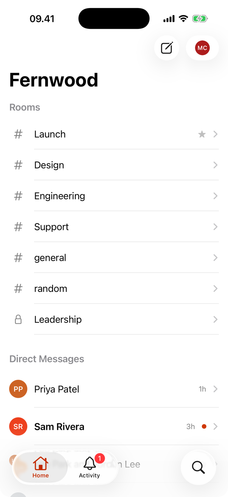
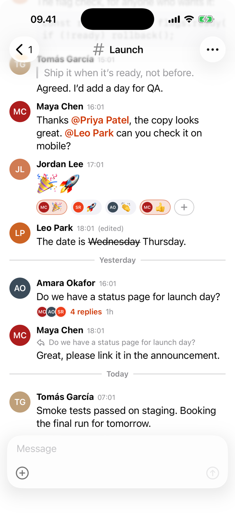
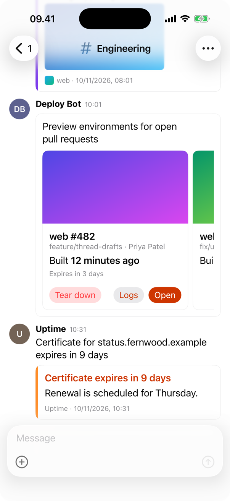

# Ember for iOS

An iPhone app for [Ember](https://github.com/NYLLON-SOFTWARE/ember-cloudflare), built on the [Ember Swift SDK](https://github.com/lloydhumphreys/ember-swift-sdk).

<p>
  <picture>
    <source media="(prefers-color-scheme: dark)" srcset="docs/screenshots/rooms-dark.png">
    
  </picture>
  <picture>
    <source media="(prefers-color-scheme: dark)" srcset="docs/screenshots/room-dark.png">
    
  </picture>
  <picture>
    <source media="(prefers-color-scheme: dark)" srcset="docs/screenshots/cards-dark.png">
    
  </picture>
</p>

## Status

The app has been built and tested against the SDK's stand-in server, which mirrors Ember's protocol and tracks Ember release 0.4.2. It has not yet been exercised end to end against a production Ember server. It runs on iPhone only; there is no iPad layout.

There are no push notifications. Ember's server delivers Web Push to browser push services only, so a native app needs a change on the server first.

## What it covers

**Connecting and signing in.** You enter a server address, and the app checks that it is an Ember server. It then signs in with email and password, or with just a name when the server allows guests. The server and the session are remembered between launches. A server that hasn't been set up yet is opened in Safari for first-run setup.

**Home.** Rooms, with starred ones first, and direct messages, with suggested people to start one with. Swipe a row to star it or mute it. Long-press a row to set its notification level. Unread rooms are bold and muted rooms are dimmed. New Message starts a direct message with one or more people from the directory. The account menu has an appearance setting (system, light or dark) and Sign Out.

**Activity.** Unread rooms, with the count on the tab.

**Rooms.** The timeline is newest at the bottom, pages in older and newer history as you scroll, and has a Jump to Latest button. Messages fall under day headings, and messages one person sends close together are grouped. Messages that mention you are highlighted. Edited and deleted messages are marked. Typing indicators are shown, and the room is marked read as you open and leave it. The back button shows how many other rooms are unread.

**Messages.** Long-press a message to reply in a thread, boost it (from presets or your own text), copy it, select its text, edit it or delete it. Edit and delete are offered only where Ember allows them. Boosts show as chips under the message. Tap your own boost to remove it, or tap + to add one.

**Composing.** A plain-text composer, with photos, videos and files attached from the photo library or the Files app. Staged files show above the field and can be removed before sending. Uploads show progress. A message that fails to send can be retried or discarded. Editing reuses the composer and changes only the part of the body you touched, so formatting elsewhere in the message is kept.

**Threads.** A thread shows the parent and its replies. The reply composer can also send the reply to the room, or to the direct message. In the room, a thread shows a summary with faces, a reply count and the time of the latest reply.

**Message bodies.** Paragraphs, headings, code blocks, quotes, lists, tables, rules, link previews and mentions are drawn natively. Emoji-only messages are shown large. Images are shown inline at their stored proportions. Videos show a poster and open in the system player. Other files show as a row and open when tapped. A tapped link opens only if it is http, https, `mailto` or `tel`.

**Bot cards.** Ember's card attachments: colour bar, author, title, fields, sections, buttons, tables, context rows, images, tiles, footers and "Show more" for long text.

**Search.** Search messages, with filters for room, person, mentions of you, links, files and threads, sorted newest or oldest first. Matched words are highlighted and recent searches are kept. Tapping a result opens the room or thread at that message.

## Not there yet

Compared with Ember's web client:

- A rich-text composer (bold, lists, code) and @mention autocomplete. The composer sends plain text.
- Quote and Copy link in the message menu.
- Presence: who is in a room now.
- Inline video playback.
- Creating rooms, and room settings.
- Profiles and the people list.
- Workspace, admin, bot and assistant settings.
- Invitations, join links and QR sign-in.
- Signing in with Memberful. First-run setup is done in Safari.
- Custom room icons and branding. Rooms show a number sign or a lock.
- Push notifications (see Status).
- iPad.

## Getting it running

You need Xcode 26, because the app targets iOS 26. You also need [XcodeGen](https://github.com/yonaskolb/XcodeGen).

```bash
brew install xcodegen
```

The app uses the SDK as a local package at `../ember-swift-sdk`, so clone both repositories into the same folder.

```bash
git clone https://github.com/lloydhumphreys/ember-swift-sdk
```

```bash
git clone https://github.com/lloydhumphreys/ember-ios
```

```bash
cd ember-ios
```

The Xcode project is generated from `project.yml` and isn't checked in.

```bash
xcodegen generate
```

```bash
open Ember.xcodeproj
```

Choose the `Ember` scheme and an iPhone simulator, then run. A simulator build needs no signing setup. Run `xcodegen generate` again after adding or removing files.

## Trying it without a server

The SDK includes a stand-in server, so you can try the app without deploying Ember. It is a small Node script (Node 18 or later, no dependencies) that speaks Ember's HTTP and socket protocol, with seeded people, rooms, threads, files and bot cards. State is held in memory and resets on each start.

Every seeded account uses one password, which you choose. The server reads it from `EMBER_SEED_PASSWORD`, or else from `.dev/seed-password` at the root of the SDK checkout. It never prints the password. From the SDK checkout:

```bash
cd ../ember-swift-sdk
```

```bash
export EMBER_SEED_PASSWORD='choose-a-password'
```

```bash
node Tools/mock-server/server.mjs
```

On start-up the server prints the address it is listening on and the administrator account to sign in as. In the app, enter `127.0.0.1:8787` as the server, then sign in with that account and your password. The other seeded accounts are listed in `Tools/mock-server/README.md`, along with the variables for guest sign-in, the scripted replier and search paging.

## Pointing it at a real Ember server

Enter the server's address on the first screen. `https://` is assumed unless the host is local, so `chat.example.com` is enough. To switch servers later, sign out and tap Change next to the server on the sign-in screen.

## Running on a device

A device build needs a development team and a bundle ID that belongs to it. `Config/Shared.xcconfig` includes `Config/Local.xcconfig` if it exists, and git ignores that file. Copy the template and fill in both values:

```bash
cp Config/Local.example.xcconfig Config/Local.xcconfig
```

```
DEVELOPMENT_TEAM = YOUR_TEAM_ID
EMBER_BUNDLE_ID = com.yourname.ember
```

Then choose your device in Xcode and run.

## Running the tests

The tests are in `EmberTests`. They use the SDK's `EmberTesting` stand-ins and don't touch the network. Run them from Xcode with Product › Test, or from the command line with any iPhone simulator you have installed:

```bash
xcodebuild test -project Ember.xcodeproj -scheme Ember -destination 'platform=iOS Simulator,name=iPhone 17'
```

## How it is put together

The app is SwiftUI, written in Swift 6 with strict concurrency. The SDK does the networking and keeps the state: `Workspace` for the sidebar, `RoomSession` and `ThreadSession` for what is on screen. The app observes those stores and draws them. `SessionController` tracks whether you are choosing a server, signing in or signed in, and closes and reopens the sockets as the app moves between background and foreground.

- `Ember/App`: the entry point, the root view and the session controller.
- `Ember/Auth`: choosing a server and signing in.
- `Ember/Rooms`: the Home and Activity tabs, the account menu and new direct messages.
- `Ember/Room`: the timeline, messages, attachments, cards, rich text, the composer and threads.
- `Ember/Search`: search and its filters.
- `Ember/Support`: avatars, appearance and shared pieces.

## Licence and credits

MIT. See [LICENSE](LICENSE).

The app is a client for [Ember](https://github.com/NYLLON-SOFTWARE/ember-cloudflare), which grew out of [Campfire](https://github.com/basecamp/once-campfire) by 37signals. The flame mark is Ember's.
